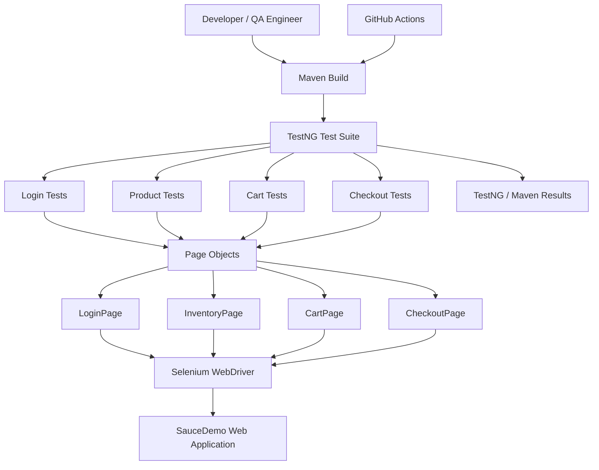
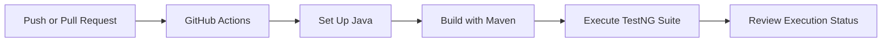

# E-Commerce Testing Automation Framework

A Java-based UI test automation framework designed to validate critical e-commerce workflows using **Selenium WebDriver, TestNG, Maven, and the Page Object Model (POM)**.

The project automates essential user journeys on [SauceDemo](https://www.saucedemo.com/), including authentication, product interactions, shopping cart operations, and checkout workflows. It also includes manual test documentation, defect-reporting templates, and a GitHub Actions workflow for continuous integration.

The framework is designed to demonstrate practical QA Automation skills, maintainable test architecture, reusable page objects, and repeatable test execution.

---

## Table of Contents

- [Project Overview](#project-overview)
- [Key Features](#key-features)
- [Technology Stack](#technology-stack)
- [Framework Architecture](#framework-architecture)
- [Project Structure](#project-structure)
- [Test Coverage](#test-coverage)
- [Prerequisites](#prerequisites)
- [Installation and Setup](#installation-and-setup)
- [Running the Tests](#running-the-tests)
- [Test Data](#test-data)
- [Manual Testing and Defect Reporting](#manual-testing-and-defect-reporting)
- [Continuous Integration](#continuous-integration)
- [Troubleshooting](#troubleshooting)
- [Learning Outcomes](#learning-outcomes)
- [Future Improvements](#future-improvements)
- [Author](#author)
- [Disclaimer](#disclaimer)

---

## Project Overview

Testing is an essential part of delivering reliable software. This project demonstrates how repetitive e-commerce UI validation can be automated using a structured test automation framework.

Instead of placing all browser interactions and assertions in a single test class, the framework separates test execution, browser setup, and page-specific operations.

### Objectives

- Automate important e-commerce user workflows.
- Validate application behavior using functional UI tests.
- Separate test logic from page locators and interactions.
- Reuse page objects across multiple test scenarios.
- Document manual test cases and defect-reporting procedures.
- Support repeatable local execution and automated CI checks.

**Application under test:** SauceDemo  
**Framework type:** UI Test Automation  
**Design pattern:** Page Object Model (POM)

---

## Key Features

- **Browser automation:** Selenium WebDriver.
- **Test execution:** TestNG test framework.
- **Build management:** Maven dependency and build management.
- **Page Object Model:** Separate page interactions from test assertions.
- **Authentication testing:** Login workflow validation.
- **Product testing:** Product listing and sorting scenarios.
- **Cart testing:** Shopping cart workflow validation.
- **Checkout testing:** Customer information and checkout flow.
- **Manual test documentation:** Structured CSV test cases.
- **Defect documentation:** Reusable bug-report template.
- **Continuous integration:** GitHub Actions workflow.
- **Version control:** Git and GitHub.

---

## Technology Stack

| Technology | Purpose |
|---|---|
| Java | Test automation programming language |
| Selenium WebDriver | Browser interaction and UI automation |
| TestNG | Test organization, execution, and assertions |
| Maven | Dependency management and build lifecycle |
| Page Object Model | Maintainable and reusable test architecture |
| Chrome | Browser used for local and CI execution |
| Git | Version control |
| GitHub | Source code hosting and collaboration |
| GitHub Actions | Automated CI test execution |
| CSV / Markdown | Manual test cases and defect documentation |

---

## Framework Architecture

The framework follows a layered design to improve maintainability and reduce duplicated browser interaction code.



### Architecture Components

**1. Test Layer**

Contains TestNG test classes responsible for defining scenarios, performing actions through page objects, and validating expected results.

**2. Base Test Layer**

`BaseTest.java` centralizes browser setup and teardown so test classes can reuse common WebDriver lifecycle operations.

**3. Page Object Layer**

Page classes encapsulate page-specific locators and interactions. This keeps test methods focused on business workflows instead of low-level browser operations.

**4. Browser Automation Layer**

Selenium WebDriver interacts with the browser and the SauceDemo application.

**5. Execution and CI Layer**

Maven runs the configured test suite locally. GitHub Actions provides an automated execution workflow for repository changes.

---

## Project Structure

```text
Ecommerce-Testing-Automation-Framework/
│
├── .github/
│   └── workflows/
│       └── maven-tests.yml
│
├── src/
│   └── test/
│       └── java/
│           ├── base/
│           │   └── BaseTest.java
│           │
│           ├── pages/
│           │   ├── LoginPage.java
│           │   ├── InventoryPage.java
│           │   ├── CartPage.java
│           │   └── CheckoutPage.java
│           │
│           └── tests/
│               ├── LoginTests.java
│               ├── ProductTests.java
│               ├── CartTests.java
│               └── CheckoutTests.java
│
├── manual-test-cases/
│   └── manual-test-cases.csv
│
├── test-data/
│   └── test-data-notes.md
│
├── bug-reports/
│   └── BUG-REPORT-TEMPLATE.md
│
├── .gitignore
├── LICENSE
├── pom.xml
├── testng.xml
└── README.md
```

*The structure above documents the framework layout established for this project. Keep it synchronized with the actual repository whenever files are added, removed, or renamed.*

---

## Test Coverage

The framework is organized around four primary testing modules.

| Module | Test scenarios |
|---|---|
| Login | Valid and invalid login scenarios |
| Products | Product listing and sorting validation |
| Shopping Cart | Adding products and validating cart contents |
| Checkout | Customer information and checkout workflow |

### Testing Approaches

**Functional testing**

Checks whether application features behave according to their expected functionality.

**Positive testing**

Validates workflows using acceptable input and expected user actions.

**Negative testing**

Checks how the application responds to invalid credentials or invalid input where supported by the test cases.

**Regression testing**

Allows previously implemented scenarios to be executed again after code or configuration changes.

> Test coverage describes the scenarios the framework is intended to validate. Actual coverage and pass/fail results should be reported only after executing the tests and reviewing the results.

---

## Prerequisites

Install the following before running the project:

- **Java JDK 17 or compatible version** supported by the project's `pom.xml`.
- **Apache Maven** or a compatible Maven Wrapper, if included.
- **Google Chrome** browser.
- **Git**, if cloning the repository.
- **Visual Studio Code** with the Java extensions, or another Java IDE.
- An active internet connection for dependencies and the demo website.

Verify your installation in the VS Code terminal:

```powershell
java -version
mvn -version
git --version
```

If a command is not recognized, install the relevant software and configure the system `PATH` before proceeding.

---

## Installation and Setup

### 1. Clone the repository

```powershell
git clone https://github.com/Kshitij7498/Ecommerce-Testing-Automation-Framework.git
```

### 2. Open the project

```powershell
cd Ecommerce-Testing-Automation-Framework
code .
```

Alternatively, open the cloned directory directly in Visual Studio Code.

### 3. Resolve Maven dependencies

```powershell
mvn clean
```

Maven reads `pom.xml` and resolves the project's configured dependencies when required.

### 4. Review the TestNG suite

Inspect `testng.xml` to understand which test classes are included in the configured suite.

---

## Running the Tests

### Run the complete Maven test suite

```powershell
mvn clean test
```

This cleans the build output, compiles the project, and executes the configured tests through Maven and TestNG.

### Run in headless mode

If the framework supports the `headless` system property through its browser setup:

```powershell
mvn clean test -Dheadless=true
```

### Run a specific test class

For example, to execute the login tests:

```powershell
mvn -Dtest=LoginTests test
```

Use the exact class name defined in the repository.

### View test results

Maven Surefire commonly writes execution reports under:

```text
target/surefire-reports/
```

Inspect the generated reports to review passed tests, failures, skipped tests, and error details. The exact output depends on the Maven and TestNG configuration.

**Important:** Run these commands locally and confirm the actual results before documenting a pass rate.

---

## Test Data

The framework targets SauceDemo, a demo storefront intended for testing and practice.

Example public demo credentials:

| Field | Value |
|---|---|
| URL | https://www.saucedemo.com/ |
| Username | `standard_user` |
| Password | `secret_sauce` |

Use these credentials only on the official demo application. Do not reuse real account credentials or commit personal passwords, access tokens, or other secrets to GitHub.

Refer to `test-data/test-data-notes.md` for the project's test-data notes.

---

## Manual Testing and Defect Reporting

Automated tests complement manual testing; they do not eliminate the need for exploratory testing and clear defect documentation.

### Manual Test Cases

The file `manual-test-cases/manual-test-cases.csv` organizes scenarios using fields such as:

- Test case ID
- Test scenario
- Preconditions or steps
- Expected result
- Priority
- Test type

### Defect Reporting

Use `bug-reports/BUG-REPORT-TEMPLATE.md` to document reproducible defects.

A useful defect report should contain:

- Clear defect title
- Environment and affected workflow
- Steps to reproduce
- Expected result
- Actual result
- Severity and priority
- Evidence, such as sanitized screenshots

Do not report an issue as a confirmed defect until you have reproduced it and checked the expected behavior.

---

## Continuous Integration

The project includes a GitHub Actions workflow:

```text
.github/workflows/maven-tests.yml
```

The workflow is intended to automate Maven test execution when configured repository events occur.

### CI Workflow



Check the workflow file to confirm the configured Java version, triggers, browser setup, and Maven commands.

To inspect CI results:

1. Open the GitHub repository.
2. Select the **Actions** tab.
3. Open the relevant workflow run.
4. Review the build logs and test execution status.

CI results depend on the workflow configuration and the current state of the code. Do not claim a successful CI build until a run has completed successfully.

---

## Troubleshooting

### Maven is not recognized

Install Maven or configure its `bin` directory in the system `PATH`. Restart the terminal and run `mvn -version`.

### Java version mismatch

Compare `java -version` with the Java version configured in `pom.xml` and the GitHub Actions workflow.

### Chrome or browser startup fails

Check that Chrome is installed and that the Selenium/browser-driver configuration is compatible with the environment.

### Tests fail because of element timing

Inspect the failing locator and browser logs. Prefer appropriate explicit waits over arbitrary fixed delays where the framework allows them.

### Tests fail inconsistently

Re-run the failing test and investigate whether the cause is timing, browser setup, network availability, test-data assumptions, or an actual application issue. Avoid hiding genuine failures with unnecessary retries.

---

## Learning Outcomes

This project provides practical experience with:

- Fundamentals of software testing and test automation
- Selenium WebDriver browser interaction
- Java-based test development
- TestNG test organization and assertions
- Maven build and dependency management
- Page Object Model architecture
- Positive and negative test design
- Test data and test documentation
- Defect reporting and failure investigation
- Git, GitHub, and continuous integration workflows

---

## Future Improvements

Potential enhancements for subsequent versions include:

- Expand negative and boundary-value test scenarios.
- Introduce data-driven testing for multiple input combinations.
- Add configurable browser selection.
- Improve structured logging and failure diagnostics.
- Add screenshots on test failure.
- Publish richer HTML execution reports.
- Extend CI configuration with test artifacts and clearer summaries.
- Integrate API testing and database validation as separate testing modules.

These are planned enhancements and should be marked as implemented only after they have been added and verified.

---

## Author

**Kshitij Raghatate**

- GitHub: [Kshitij7498](https://github.com/Kshitij7498)
- LinkedIn: [kshitij-raghatate](https://linkedin.com/in/kshitij-raghatate-a39722275)

---

## Disclaimer

This is an educational and portfolio project created to demonstrate software testing and UI automation practices. The framework targets the public SauceDemo practice application and is not affiliated with or endorsed by Sauce Labs.
